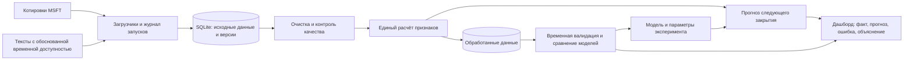

# Архитектура и статус компонентов

## Реализованная проверка MSFT

Код — `scripts/audit_microsoft.py`. Кэш хранится локально, отчёты и контрольные суммы — в Git. Проверки парсинга находятся в `tests/`. Этот контур не обучает модель и не выдаёт прогноз.

## Целевая система MSFT — план реализации

Уже реализована загрузка: `scripts/ingest_msft.py` → `src/stocks_forecast/msft_ingest.py`, конфигурация `config/msft.json`, база `data/msft.sqlite`. Аудитор и загрузчик используют общий парсер `microsoft_source.py`. Исходные ответы сохраняются в `data/raw/msft/` по хешам, в SQLite — версии цен и текстов, очередь URL, наблюдения, события корпоративных действий и журнал запусков/ошибок. Правила повторного обхода и ограничения описаны в [инструкции](msft_ingestion.md). Остальные блоки схемы ниже ещё предстоит реализовать.

Пользовательские вопросы описаны в [спецификации MSFT](msft_working_spec.md). Протокол согласован 16 октября: использовать текущие тексты с датой публикации и явно описанным ограничением исторических редакций. Дата публикации сама по себе не подтверждает доступность текущего содержимого в прошлом; поиск первоначальных версий преподаватель не требует.

Общий расчёт признаков должен использоваться для обучения и текущего прогноза. Временное разбиение предшествует обучению кодировщиков, словарей и моделей. `config/config.yaml` обслуживает SBER, `config/msft.json` — загрузку MSFT.

## Существующий SBER

Прежние модули сохранены в `src/stocks_forecast/`; [описание и ограничения](sber_prototype.md). Модели и интерфейс ещё не переведены на MSFT; новый загрузчик использует отдельную базу.
