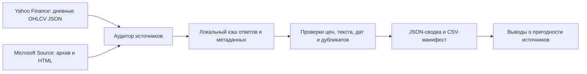
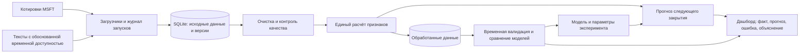

# Архитектура и статус компонентов

## Реализованная проверка MSFT

Код — `scripts/audit_microsoft.py`. Кэш хранится локально, отчёты и контрольные суммы — в Git. Проверки парсинга находятся в `tests/`. Этот контур не обучает модель и не выдаёт прогноз.

## Целевая система MSFT — план реализации

Пользовательские вопросы описаны в [спецификации MSFT](msft_working_spec.md). Протокол согласован 16 октября: использовать текущие тексты с датой публикации и явно описанным ограничением исторических редакций. Дата публикации сама по себе не подтверждает доступность текущего содержимого в прошлом; поиск первоначальных версий преподаватель не требует.

Общий расчёт признаков должен использоваться для обучения и текущего прогноза. Временное разбиение предшествует обучению кодировщиков, словарей и моделей. Параметры выносятся в конфигурацию; существующий `config/config.yaml` пока обслуживает только SBER.

## Существующий SBER

Код сохранён в `src/stocks_forecast/`; [описание и ограничения](sber_prototype.md). Наличие этих модулей не означает, что загрузка, модели и интерфейс переведены на MSFT.
