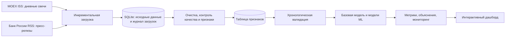

# Постановка задачи и архитектура (черновик)

## Архитектура

## Схема прогнозирования

Один пример соответствует торговому дню `t`. Признаки используют котировки, известные к закрытию дня `t`, и новости, опубликованные не позднее этого времени. Цель — `close` следующего торгового дня. Перед обучением цель сдвигается на один торговый день вперёд; после сдвига строки без будущей цели удаляются. Сначала резервируется самый поздний период для теста, а настройки выбираются на более ранней валидации.

## Источники и ограничения

MOEX ISS предоставляет свечи по инструментам биржи. Для слабоструктурированных данных загружаются официальные пресс-релизы Банка России из открытой RSS-ленты. Лента может иметь ограниченную глубину и не является архивом новостей о конкретной компании. Перед сравнением оцениваются диапазон дат и плотность записей; если покрытие недостаточно для честного теста, ограничение описывается в отчёте и новостные признаки не интерпретируются как полноценная история.

## Дополнительные компоненты

Для каждой ML-модели набор признаков выбирается по MAE validation; наивный прогноз остаётся базовой точкой сравнения. По текущему расчёту выбрана линейная регрессия с пятью ценовыми признаками (validation MAE 3,29 руб.), немного лучше базового прогноза (3,31 руб.). RSS Банка России дал 15 записей за 11.09–08.10.2026; это 11 из 2 180 строк признаков (0,50%). При заданном пороге покрытия 20% текстовые признаки не входят в обучение, чтобы не трактовать отсутствие исторических публикаций как нулевую новостную активность.

Исторический мониторинг сохраняет абсолютную ошибку каждого прогноза отложенного теста, MAE по календарным месяцам и скользящую MAE на последних 20 сессиях. Если последняя MAE больше 1,5 от MAE выбранной модели на валидации, статус становится `review`. Это порог для проверки аналитиком, а не статистическое доказательство дрейфа. Расчёт сделан на отложенной истории; при эксплуатации мониторинг следует обновлять после появления фактической цены.

## Проверка признаков и объяснение прогнозов

Календарные признаки представлены синусом и косинусом дня недели, месяца и дня месяца, чтобы сохранить циклический характер календаря. В `reports/feature_analysis.json` сравниваются группы признаков по MAE на валидации; наивная модель, линейная регрессия, случайный лес и градиентный бустинг оцениваются на одинаковых временных границах. Для деревьев сопоставлены встроенная важность и permutation importance. Последняя рассчитана на валидации и отдельно на тестовом отрезке, только после выбора модели; тестовая важность не влияет на отбор.

Дашборд применяет выбранную обученную модель к последнему набору признаков. Для линейной модели он показывает локальное объяснение: как отклонение каждого признака от медианы train меняет прогноз при фиксированных остальных признаках. Дашборд также позволяет выбрать тестовую дату и посмотреть факт, прогноз и ошибку. Для ML-кандидатов приведены диагностические кривые частичной зависимости по цене и доходности; они показывают усреднённую связь модели с признаком и не являются причинным эффектом.

## Ограничение источника слабоструктурированных данных

Открытая лента Банка России содержит короткий набор общих пресс-релизов, не исторический корпус новостей SBER. Покрытие составило 0,50% торговых сессий, поэтому текстовые признаки не включены в обучение. Открытая страница раскрытия информации Сбербанка содержит сообщения о событиях, потенциально влияющих на котировки, однако полная историческая выгрузка в проект пока не автоматизирована. Ограничение сохраняется в отчёте и презентации; результаты нельзя представлять как доказательство полезности текстовых данных.
